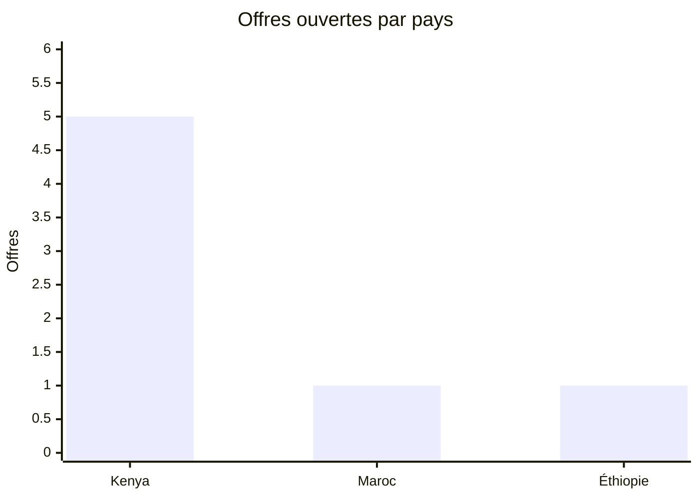
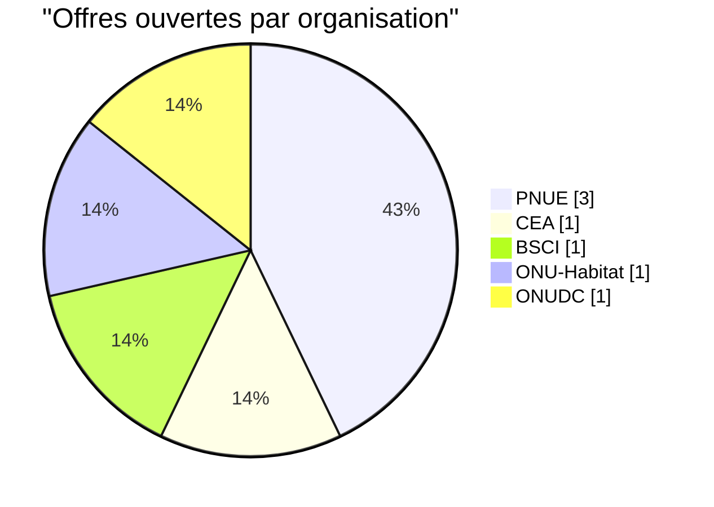

# 💼 Offres d'emploi tech en Afrique

**Les postes en informatique, data, développement, systèmes d'information, GIS et statistiques publiés en Afrique par l'ONU, l'UNESCO, l'Union africaine et la Banque africaine de développement.**

Cette page est mise à jour automatiquement chaque matin. Cliquez sur le titre d'une offre pour lire la fiche complète et postuler sur le site officiel de l'organisation.

> **7 offres ouvertes** dans **3 pays** · **7 nouvelles offres** aujourd'hui · mise à jour le 22 novembre 2026

**Aller directement à un pays :** [🇰🇪 Kenya (5)](#kenya) · [🇲🇦 Maroc (1)](#maroc) · [🇪🇹 Éthiopie (1)](#ethiopie)

## ⏳ Ferment dans les 7 prochains jours

| Poste | Organisation | Lieu | Clôture |
|---|---|---|---|
| [ACS/Data Innovation and Analytics](https://careers.un.org/jobSearchDescription/287673?language=en) | CEA | Addis Ababa, Éthiopie | 23 novembre 2026 (demain) |
| [Programme Officer (Migrant Smuggling and Cybercrime Investigation) - temporary](https://careers.un.org/jobSearchDescription/287979?language=en) | ONUDC | Rabat, Maroc | 23 novembre 2026 (demain) |
| [Intern - Data analytics](https://careers.un.org/jobSearchDescription/287931?language=en) | ONU-Habitat | Nairobi, Kenya | 25 novembre 2026 (dans 3 jours) |
| [Information Systems  Intern](https://careers.un.org/jobSearchDescription/288738?language=en) | PNUE | Nairobi, Kenya | 28 novembre 2026 (dans 6 jours) |

## 🆕 Nouvelles offres du jour

| Poste | Organisation | Lieu | Clôture |
|---|---|---|---|
| [ACS/Data Innovation and Analytics](https://careers.un.org/jobSearchDescription/287673?language=en) | CEA | Addis Ababa, Éthiopie | 23 novembre 2026 (demain) |
| [Programme Officer (Migrant Smuggling and Cybercrime Investigation) - temporary](https://careers.un.org/jobSearchDescription/287979?language=en) | ONUDC | Rabat, Maroc | 23 novembre 2026 (demain) |
| [Intern - Data analytics](https://careers.un.org/jobSearchDescription/287931?language=en) | ONU-Habitat | Nairobi, Kenya | 25 novembre 2026 (dans 3 jours) |
| [Information Systems  Intern](https://careers.un.org/jobSearchDescription/288738?language=en) | PNUE | Nairobi, Kenya | 28 novembre 2026 (dans 6 jours) |
| [Senior Consultant: Scientific Assessment and Expert Group Coordination on the Environmental Sustainability of Artificial Intelligence](https://careers.un.org/jobSearchDescription/288720?language=en) | PNUE | Nairobi, Kenya | 30 novembre 2026 (dans 8 jours) |
| [Software Application Developer](https://careers.un.org/jobSearchDescription/288576?language=en) | PNUE | Nairobi, Kenya | 30 novembre 2026 (dans 8 jours) |
| [DIGITAL FORENSIC INVESTIGATOR](https://careers.un.org/jobSearchDescription/282126?language=en) | BSCI | Nairobi, Kenya | 12 décembre 2026 (dans 20 jours) |

## 🌍 Toutes les offres, par pays

### 🇰🇪 Kenya (5)

- **[Intern - Data analytics](https://careers.un.org/jobSearchDescription/287931?language=en)** 🆕  
  ONU-Habitat · Nairobi · Stage  
  Clôture : 25 novembre 2026 (dans 3 jours)

- **[Information Systems  Intern](https://careers.un.org/jobSearchDescription/288738?language=en)** 🆕  
  PNUE · Nairobi · Stage  
  Clôture : 28 novembre 2026 (dans 6 jours)

- **[Senior Consultant: Scientific Assessment and Expert Group Coordination on the Environmental Sustainability of Artificial Intelligence](https://careers.un.org/jobSearchDescription/288720?language=en)** 🆕  
  PNUE · Nairobi · Consultant  
  Clôture : 30 novembre 2026 (dans 8 jours)

- **[Software Application Developer](https://careers.un.org/jobSearchDescription/288576?language=en)** 🆕  
  PNUE · Nairobi · Consultant  
  Clôture : 30 novembre 2026 (dans 8 jours)

- **[DIGITAL FORENSIC INVESTIGATOR](https://careers.un.org/jobSearchDescription/282126?language=en)** 🆕  
  BSCI · Nairobi · Professionnel (P-4)  
  Clôture : 12 décembre 2026 (dans 20 jours)

[↑ Retour en haut](#haut)

### 🇲🇦 Maroc (1)

- **[Programme Officer (Migrant Smuggling and Cybercrime Investigation) - temporary](https://careers.un.org/jobSearchDescription/287979?language=en)** 🆕  
  ONUDC · Rabat · Professionnel (P-3)  
  ⏳ **Clôture : 23 novembre 2026 (demain)**

[↑ Retour en haut](#haut)

### 🇪🇹 Éthiopie (1)

- **[ACS/Data Innovation and Analytics](https://careers.un.org/jobSearchDescription/287673?language=en)** 🆕  
  CEA · Addis Ababa · Consultant  
  ⏳ **Clôture : 23 novembre 2026 (demain)**

[↑ Retour en haut](#haut)

## 📊 En chiffres

## ℹ️ Bon à savoir

**Comment lire le niveau d'un poste**

- **Stage** : stage, généralement pour étudiants ou jeunes diplômés.
- **Consultant** : contrat de courte durée, pour une mission précise.
- **Professionnel (P-1 à P-5, PL à la BAD)** : poste de cadre, avec recrutement international.
- **Administrateur national (NO)** : poste de cadre réservé aux ressortissants du pays où se trouve le poste.
- **Services généraux (G, GS)** : poste d'appui, recruté sur place.

**Pour postuler**

- La candidature se fait toujours sur le site officiel de l'organisation, en suivant le lien de l'offre.
- Les organisations internationales ne demandent jamais de frais pour postuler. Méfiez-vous de toute demande de paiement.
- Vérifiez la date de clôture et les conditions (nationalité, langues, expérience) sur la fiche de l'offre.

**Organisations suivies**

- [ONU](https://careers.un.org) : Secrétariat de l'ONU : CEA, PNUE, ONU-Habitat, OCHA, missions de paix...
- [UNESCO](https://careers.unesco.org) : Organisation des Nations unies pour l'éducation, la science et la culture
- [UA](https://jobs.au.int) : Union africaine
- [BAD](https://www.afdb.org/en/about-careers/current-vacancies) : Banque africaine de développement

---

Les offres appartiennent aux organisations qui les publient. Cette page reprend uniquement le titre, le lieu, le niveau et les dates, avec un lien vers l'annonce officielle. Fonctionnement du projet : [TECHNIQUE.md](TECHNIQUE.md).
