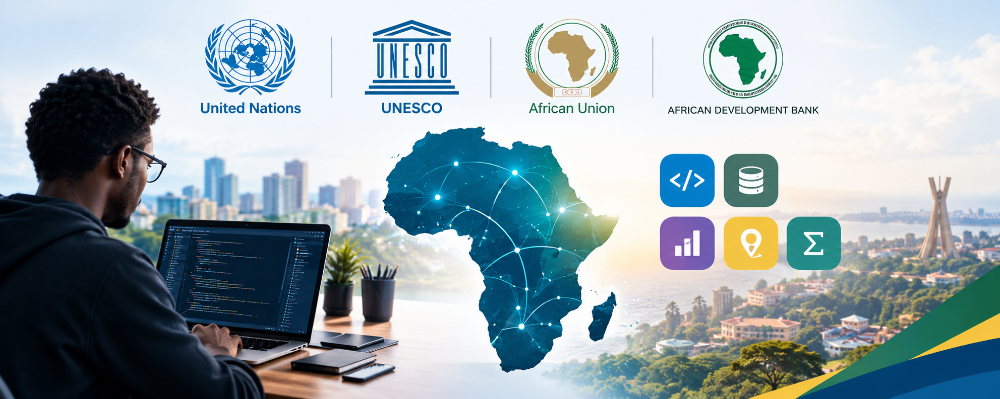
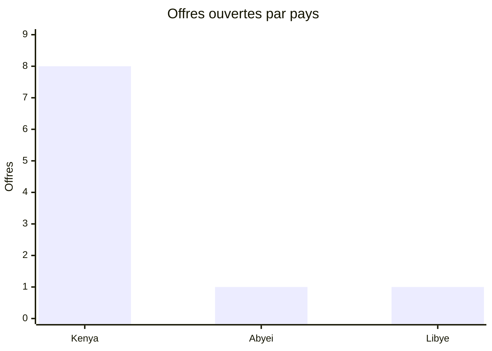
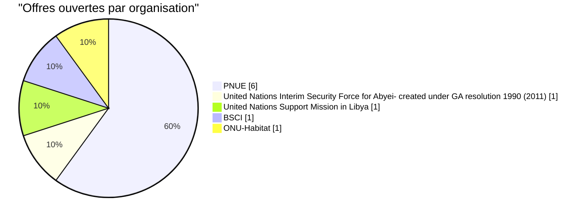
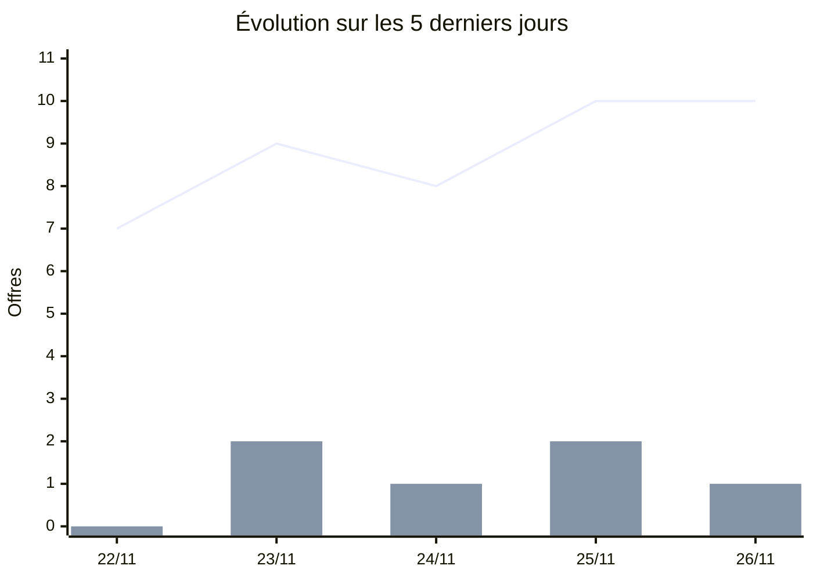

# Offres d'emploi tech en Afrique

Les postes en informatique, data, développement, GIS et statistiques publiés en Afrique par l'ONU, l'UNESCO, l'Union africaine et la Banque africaine de développement. La page est mise à jour chaque matin.

**10 offres ouvertes · 3 pays · 1 nouvelle aujourd'hui** · mise à jour le 26 novembre 2026

> Source indisponible aujourd'hui : Banque africaine de développement. Les offres déjà connues restent affichées jusqu'à leur clôture.

Pays : [Kenya (8)](#kenya) · [Abyei (1)](#abyei) · [Libye (1)](#libye)

## Ferment dans les 7 prochains jours

| Poste | Organisation | Lieu | Clôture |
|---|---|---|---|
| [INFORMATION SYSTEMS ASSISTANT](https://careers.un.org/jobSearchDescription/288895?language=en) | United Nations Support Mission in Libya | Tripoli (Libya), Libye | **28 nov. 2026, dans 2 jours** |
| [Information Systems  Intern](https://careers.un.org/jobSearchDescription/288738?language=en) | PNUE | Nairobi, Kenya | **28 nov. 2026, dans 2 jours** |
| [Senior Consultant: Scientific Assessment and Expert Group Coordination on the Environmental Sustainability of Artificial Intelligence](https://careers.un.org/jobSearchDescription/288720?language=en) | PNUE | Nairobi, Kenya | 30 nov. 2026, dans 4 jours |
| [Software Application Developer](https://careers.un.org/jobSearchDescription/288576?language=en) | PNUE | Nairobi, Kenya | 30 nov. 2026, dans 4 jours |
| [INFORMATION SYSTEMS ASSISTANT](https://careers.un.org/jobSearchDescription/289094?language=en) | United Nations Interim Security Force for Abyei- created under GA resolution 1990 (2011) | Abyei, Abyei | 1er déc. 2026, dans 5 jours |
| [Digital Skills Programme Consultant](https://careers.un.org/jobSearchDescription/288744?language=en) | PNUE | Nairobi, Kenya | 2 déc. 2026, dans 6 jours |
| [Digital Policy and AI Consultant](https://careers.un.org/jobSearchDescription/288799?language=en) | PNUE | Nairobi, Kenya | 3 déc. 2026, dans 7 jours |

## Toutes les offres

### Kenya

| Poste | Organisation | Ville | Niveau | Clôture |
|---|---|---|---|---|
| [Information Systems  Intern](https://careers.un.org/jobSearchDescription/288738?language=en) | PNUE | Nairobi | Stage | **28 nov. 2026, dans 2 jours** |
| [Senior Consultant: Scientific Assessment and Expert Group Coordination on the Environmental Sustainability of Artificial Intelligence](https://careers.un.org/jobSearchDescription/288720?language=en) | PNUE | Nairobi | Consultant | 30 nov. 2026, dans 4 jours |
| [Software Application Developer](https://careers.un.org/jobSearchDescription/288576?language=en) | PNUE | Nairobi | Consultant | 30 nov. 2026, dans 4 jours |
| [Digital Skills Programme Consultant](https://careers.un.org/jobSearchDescription/288744?language=en) | PNUE | Nairobi | Consultant | 2 déc. 2026, dans 6 jours |
| [Digital Policy and AI Consultant](https://careers.un.org/jobSearchDescription/288799?language=en) | PNUE | Nairobi | Consultant | 3 déc. 2026, dans 7 jours |
| [Charging Infrastructure & Transport Data Consultant](https://careers.un.org/jobSearchDescription/289005?language=en) | PNUE | Nairobi | Consultant | 4 déc. 2026, dans 8 jours |
| [Scientific Coordinator Consultant of the Local2030 Knowledge and Scientific Network](https://careers.un.org/jobSearchDescription/287101?language=en) *(nouveau)* | ONU-Habitat | Nairobi | Consultant | 5 déc. 2026, dans 9 jours |
| [DIGITAL FORENSIC INVESTIGATOR](https://careers.un.org/jobSearchDescription/282126?language=en) | BSCI | Nairobi | Professionnel (P-4) | 12 déc. 2026, dans 16 jours |

[Retour en haut](#haut)

### Abyei

| Poste | Organisation | Ville | Niveau | Clôture |
|---|---|---|---|---|
| [INFORMATION SYSTEMS ASSISTANT](https://careers.un.org/jobSearchDescription/289094?language=en) | United Nations Interim Security Force for Abyei- created under GA resolution 1990 (2011) | Abyei | Services généraux (G-5) | 1er déc. 2026, dans 5 jours |

[Retour en haut](#haut)

### Libye

| Poste | Organisation | Ville | Niveau | Clôture |
|---|---|---|---|---|
| [INFORMATION SYSTEMS ASSISTANT](https://careers.un.org/jobSearchDescription/288895?language=en) | United Nations Support Mission in Libya | Tripoli (Libya) | Service mobile (FS-5) | **28 nov. 2026, dans 2 jours** |

[Retour en haut](#haut)

## En chiffres

Afficher les graphiques

_Courbe : offres ouvertes. Barres : nouvelles offres du jour._

## Bon à savoir

Comment lire le niveau d'un poste

- **Stage** : stage, généralement pour étudiants ou jeunes diplômés.
- **Consultant** : contrat de courte durée, pour une mission précise.
- **Professionnel (P-1 à P-5, PL à la BAD)** : poste de cadre, avec recrutement international.
- **Administrateur national (NO)** : poste de cadre réservé aux ressortissants du pays où se trouve le poste.
- **Services généraux (G, GS)** : poste d'appui, recruté sur place.

Conseils pour postuler

- La candidature se fait toujours sur le site officiel de l'organisation, en suivant le lien de l'offre.
- Les organisations internationales ne demandent jamais de frais pour postuler. Méfiez-vous de toute demande de paiement.
- Vérifiez la date de clôture et les conditions (nationalité, langues, expérience) sur la fiche de l'offre.

Organisations suivies

- [ONU](https://careers.un.org) : Secrétariat de l'ONU : CEA, PNUE, ONU-Habitat, OCHA, missions de paix...
- [UNESCO](https://careers.unesco.org) : Organisation des Nations unies pour l'éducation, la science et la culture
- [UA](https://jobs.au.int) : Union africaine
- [BAD](https://www.afdb.org/en/about-careers/current-vacancies) : Banque africaine de développement

---

Les offres appartiennent aux organisations qui les publient. Cette page reprend uniquement le titre, le lieu, le niveau et les dates, avec un lien vers l'annonce officielle. Fonctionnement du projet : [TECHNIQUE.md](TECHNIQUE.md).
